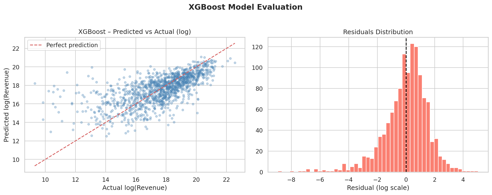
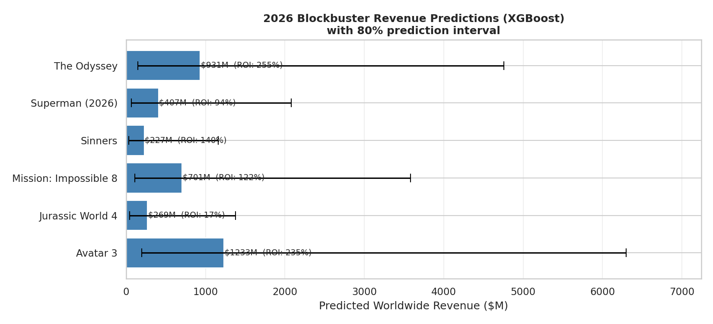

# 🎬 The Evolution of Cinema — Box Office BI & Revenue Forecast

An end-to-end data project covering 100 years of film history: a data pipeline that combines **45,000+ films** from Kaggle with recent releases from the **TMDb API**, a **machine-learning model** that forecasts worldwide box-office revenue, and an **interactive Plotly Dash dashboard** to explore it all.


## Features

- **Genre trends 1960–2025:** each genre's share of yearly releases, split by data source.
- **World map:** film production by country.
- **Budget vs. revenue:** log-scale scatter of ~6,000 films with Oscar Best Picture winners highlighted and a search box to find any film.
- **Revenue by decade:** median revenue and budget, ROI and growth index.
- **2026 forecasts:** predicted revenue for six upcoming blockbusters, with 80% intervals.
- **Live predictor:** enter a budget, genre, release month and runtime to get an instant forecast.
- **Dark/light mode and English/German UI.**

## Quick start (about 2 minutes)

The processed data and the trained model are included, so **no API keys are needed** to run the dashboard.

```bash
git clone https://github.com/keniaej/Movies-Projekt.git
cd Movies-Projekt
python -m venv .venv
source .venv/bin/activate          # Windows: .venv\Scripts\activate
pip install -r requirements.txt
python app.py
```

Then open **http://127.0.0.1:8050**.

## How it works

```
Kaggle "The Movies Dataset" (1920–2017) ─┐
TMDb API: top 200 films/year (2018–2025) ─┼─► 01_data_pipeline ─► data/*.csv ─┬─► app.py (dashboard)
Upcoming 2026 blockbusters (manual) ─────┤                                     │
Oscar Best Picture winners ──────────────┘   02_revenue_model ─► models/*.pkl.gz ┘
```

| Notebook | What it does | Open in Colab |
|---|---|---|
| [`01_data_pipeline.ipynb`](notebooks/01_data_pipeline.ipynb) | Downloads and cleans Kaggle data, fetches about 1,600 recent films from TMDb, merges and deduplicates them, adjusts for inflation and engineers features | [](https://colab.research.google.com/github/keniaej/Movies-Projekt/blob/main/notebooks/01_data_pipeline.ipynb) |
| [`02_revenue_model.ipynb`](notebooks/02_revenue_model.ipynb) | Covers EDA, compares Random Forest, XGBoost and Gradient Boosting, runs cross-validation, explains the model with SHAP and produces the 2026 forecasts | [](https://colab.research.google.com/github/keniaej/Movies-Projekt/blob/main/notebooks/02_revenue_model.ipynb) |

The notebooks are written in German; code comments and the dashboard are in English.

### Modelling choices

- **Log-transformed target:** revenue is heavily right-skewed (a few blockbusters dominate), so the model predicts `log(revenue)`.
- **Inflation adjustment:** budgets and revenues are converted to approximate 2024 USD using decade-level CPI multipliers.
- **No leakage features:** `vote_count` correlates strongly with revenue, but it is only known *after* release, so it is deliberately excluded.
- **Uncertainty:** the 80% prediction interval comes from the model's errors on held-out test films.
- **Portable model:** XGBoost is saved in its native JSON format, so it loads with any recent xgboost version.

## Results

Trained on 4,910 films with budget and revenue data and tested on 1,228 films the model had never seen.

| Model | Test R² (log revenue) | MAE |
|---|---|---|
| **XGBoost** (selected) | **0.420** | $116.7M |
| Gradient Boosting | 0.419 | $115.7M |
| Random Forest | 0.418 | $117.5M |

- **5-fold cross-validation R²: 0.47 ± 0.03.** Performance is stable across folds.
- **Median absolute error: $42M.** The mean error ($117M) is pulled up by a few blockbusters.
- **Budget is by far the strongest predictor,** followed by genre and release year.
- **Three very different algorithms land at the same R².** The limit is the information in the features, not the choice of model.



### 2026 forecasts

| Film | Budget | Forecast | 80% prediction interval |
|---|---|---|---|
| Avatar 3 | $368M | $1,233M | $194M – $6,299M |
| The Odyssey | $262M | $931M | $147M – $4,759M |
| Mission: Impossible 8 | $315M | $701M | $110M – $3,579M |
| Superman | $210M | $407M | $64M – $2,080M |
| Jurassic World 4 | $231M | $269M | $42M – $1,376M |
| Sinners | $94M | $227M | $36M – $1,159M |

The intervals are deliberately honest. They come from the model's actual errors on the test set: 80% of unseen test films landed within roughly **0.16× to 5×** of their forecast. A model that knows only budget, genre and timing can rank films sensibly, but it can't pin down a single film's revenue.



### Limitations

- **Oscar Best Picture is a weak feature.** Only about 90 films carry it, and impurity-based importance overrates rare binary features. It also isn't known before release.
- **The "upcoming 2026" list was written before most of these films came out.** Several were later released in 2025, so a comparison with their real box office is a natural next step.
- **Missing drivers.** The model only knows budget, genre, timing and runtime. The real drivers of box-office success, such as star power, marketing spend, franchise status, competition, reviews and word of mouth, are not in the data, which caps accuracy.
- **Sampling bias.** The 2018–2025 TMDb sample contains only the 200 most popular films per year, so it is biased toward hits compared with the complete Kaggle data.

## Rebuilding the data (optional)

You need a free [TMDb API key](https://www.themoviedb.org/settings/api) and a [Kaggle API token](https://www.kaggle.com/settings).

- **Colab:** add `TMDB_API_KEY`, `KAGGLE_USERNAME` and `KAGGLE_KEY` as Colab Secrets (🔑 icon), then run notebook 1 and notebook 2. The fetch from TMDb takes about 10 minutes.
- **Locally:** export the same three variables (see [`.env.example`](.env.example)) and run the notebooks from the `notebooks/` folder.

## Project structure

```
├── app.py                  # Plotly Dash dashboard
├── notebooks/
│   ├── 01_data_pipeline.ipynb
│   └── 02_revenue_model.ipynb
├── data/                   # processed CSVs used by the dashboard
├── models/                 # trained model (XGBoost JSON) + metadata
├── images/                 # charts exported by the notebooks
└── requirements.txt
```

## Data sources

- [The Movies Dataset](https://www.kaggle.com/datasets/rounakbanik/the-movies-dataset) by Rounak Banik (CC0)
- [TMDb API](https://www.themoviedb.org/documentation/api). *This product uses the TMDB API but is not endorsed or certified by TMDB.*
- Academy Award Best Picture winners: [oscars.org](https://www.oscars.org/oscars/ceremonies)
